# As-built system design (HLD and LLD)

Status: describes the code as it runs on 2026-10-13 (Multi-Timeframe checklist on `PS_Commodity`, Global Market dashboard, official MCP OAuth, Desktop fallback).

Use this document to see the complete flow. The [high-level design](high-level-design.md) and [low-level design](low-level-design.md) describe the **target** architecture (WebSocket, rules engine, local store, monitor). Sections below mark what exists today and what is still planned.

Open the Markdown preview (`Cmd+Shift+V`) to render the diagrams. PNG renders of each Mermaid diagram are in [diagrams/](diagrams/). The Mermaid blocks are the source of truth, so regenerate the PNGs after editing them.

---

## Part 1 - High-level design (HLD)

### 1.1 System context

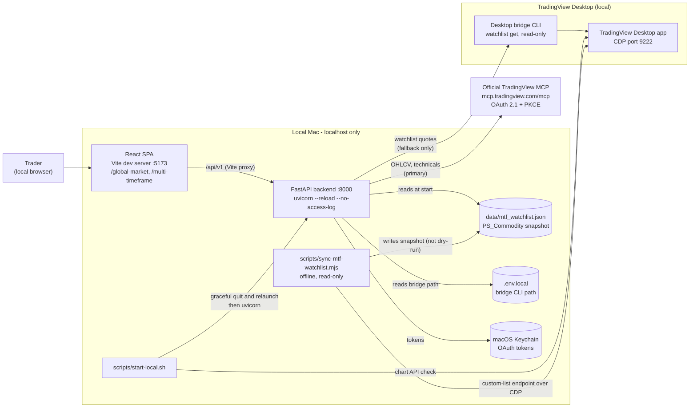

### 1.2 Layers

| Layer | Location | Responsibility | Built today |
| --- | --- | --- | --- |
| Presentation | `frontend/src/features/*`, `App.tsx` | Two pages: Global Market and Multi-Timeframe checklist | Yes |
| API | `src/god_market_api/app.py` | FastAPI routes, Pydantic response models, error mapping | Yes |
| Use cases | `mtf_analysis.py`, `global_market.py` | Load snapshot, orchestrate fetches, evaluate, build responses | Yes |
| Analysis engine | `technical_indicators.py`, `price_structure.py`, `mtf_checklist.py`, `mtf_screens.py` | Pure functions: indicators, Dow Theory, checklist cells, Double and Triple Screen | Yes |
| Orchestration and cache | `mtf_orchestrator.py`, `mtf_cache.py`, `mtf_policy.py` | Concurrency limit, in-flight deduplication, in-memory cache, freshness policy | Yes |
| Data adapters | `providers.py`, `oauth.py`, `desktop_bridge.py` | Official MCP client, OAuth token handling, Desktop CDP reader | Yes |
| Storage | `data/mtf_watchlist.json`, OS keychain, browser `localStorage` | Watchlist snapshot, credentials, theme preference | Yes |
| Realtime push, rules persistence, monitoring, alerts | none | Planned in the target design (epics E-07 to E-13) | No |

### 1.3 Source policy

| Data need | Primary | Fallback | Behaviour when both fail |
| --- | --- | --- | --- |
| Multi-Timeframe candles (6 timeframes) | Official MCP `mcp-tv-get-ohlcv` | None | Timeframe is `UNAVAILABLE` with a reason; the screen reports `INCOMPLETE — <tf> unavailable` |
| Global Market prices | Official MCP two-candle OHLC | Desktop watchlist quote, only for items the official source could not price | Item stays `UNAVAILABLE`; a warning names the Desktop failure |
| Watchlist membership (`PS_Commodity`, `PS_Global_Indices`) | Read-only Desktop read by the sync script or `start-local.sh` | Snapshot JSON on disk | Backend refuses symbols outside the snapshot (`422`) |

The backend never changes TradingView charts, watchlists or layouts.

### 1.4 Gaps between target and as-built

| Target design item | As-built status |
| --- | --- |
| WebSocket live updates to the dashboard | Built for the multi-timeframe checklist only (`/api/v1/mtf-analysis/{symbol}/live`, protocol v1; see [checklist spec](../specifications/mtf-analysis-checklist.md#live-updates-websocket-protocol-v1)). Global Market still uses TanStack Query. Rule-evaluation events are not built. |
| Local configuration and history store (SQLite or similar) | Not built. Cache is in memory and resets on restart. |
| Generic setup rules engine and setup status machine (`Data unavailable` to `Confirmed`) | Not built. The checklist and screens are fixed rules for the SMM method. |
| Monitor, state transitions, alert debounce | Not built. |
| Gmail or local notifications | Not built. |
| 1H validation against TradingView charts | Pending. The chart timeframe cannot be changed read-only. |

---

## Part 2 - Runtime flows

### 2.1 Start-up

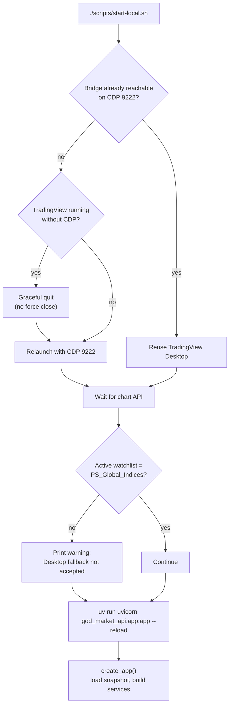

`MultiTimeframeAnalysisService` loads `data/mtf_watchlist.json` in its constructor. A missing or invalid snapshot stops the backend at start-up.

### 2.2 Multi-Timeframe analysis (`GET /api/v1/mtf-analysis/{symbol}`)

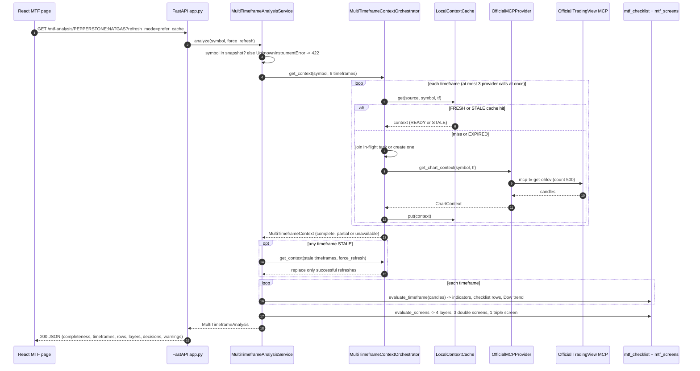

Response codes: `200` for every analysis that passes the snapshot check, including `completeness: UNAVAILABLE` when no timeframe is usable (the screens then report `INCOMPLETE`). `422` is returned for a symbol outside the snapshot.

### 2.3 Global Market snapshot (`GET /api/v1/global-market-sentiment`)

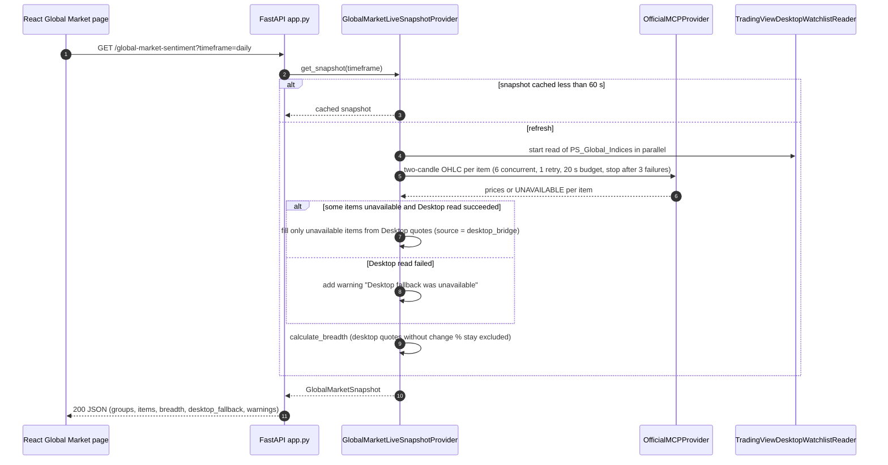

### 2.4 Official MCP OAuth (`/api/v1/oauth/official/*`)

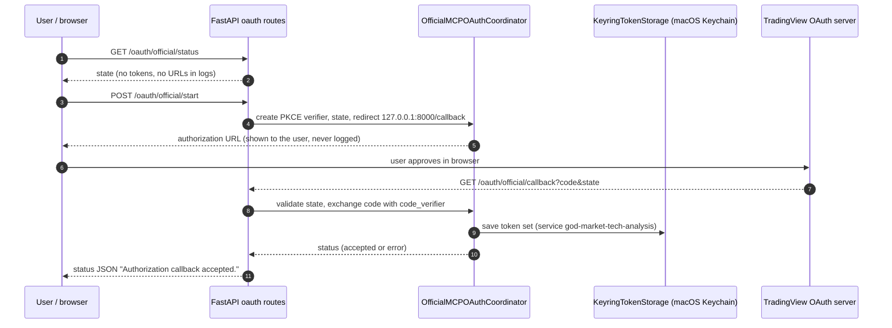

Until the callback completes, chart-context requests return `503` rather than stale or fabricated data.

### 2.5 Watchlist snapshot sync (offline, read-only)

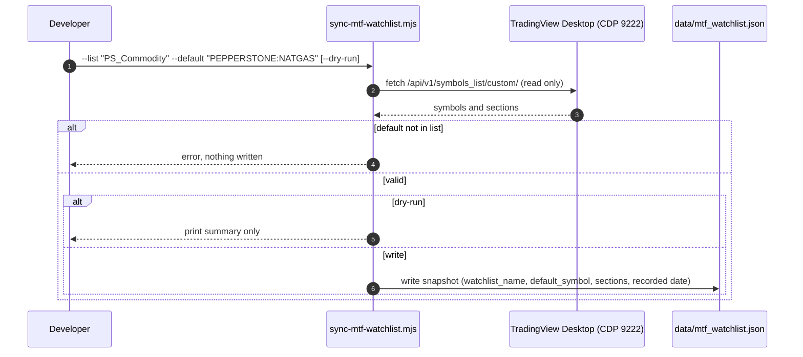

---

## Part 3 - Low-level design (LLD)

### 3.1 Backend module map

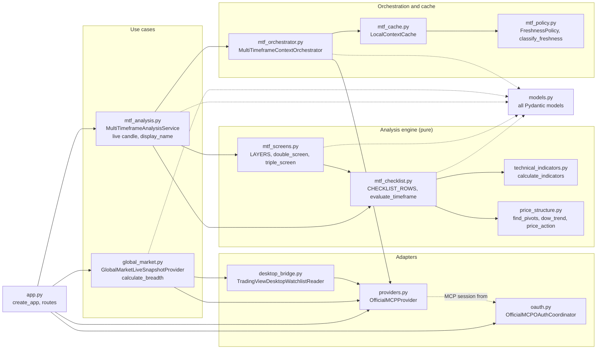

Module dependency rules that hold in the code:
- `technical_indicators.py`, `price_structure.py` and `mtf_checklist.py` do no I/O.
- Only `providers.py`, `oauth.py` and `desktop_bridge.py` talk to TradingView or the keychain.
- `app.py` is the only place where services are wired together.

### 3.2 Core data model

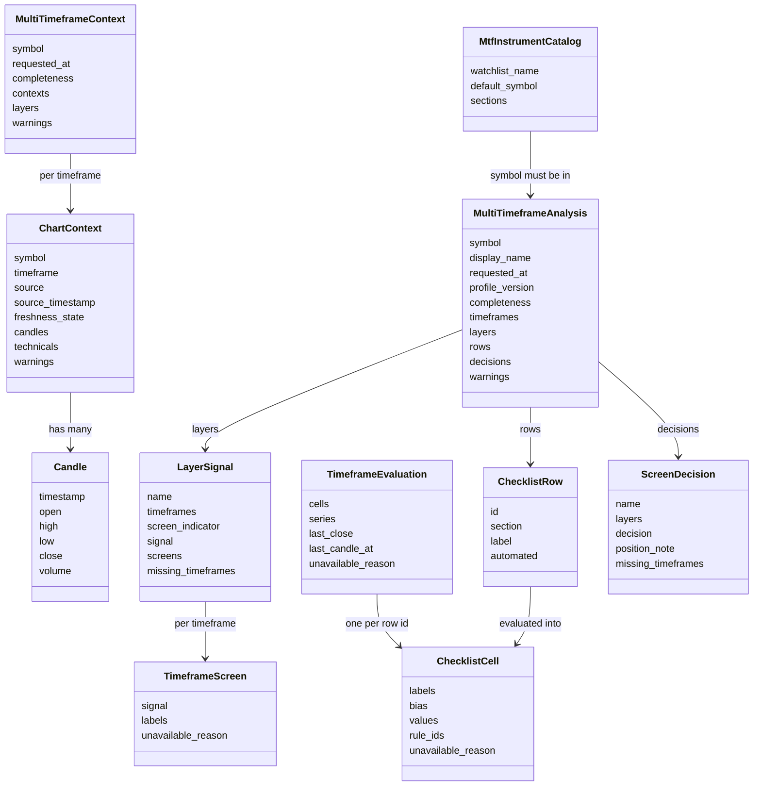

### 3.3 Per-timeframe evaluation (`evaluate_timeframe`)

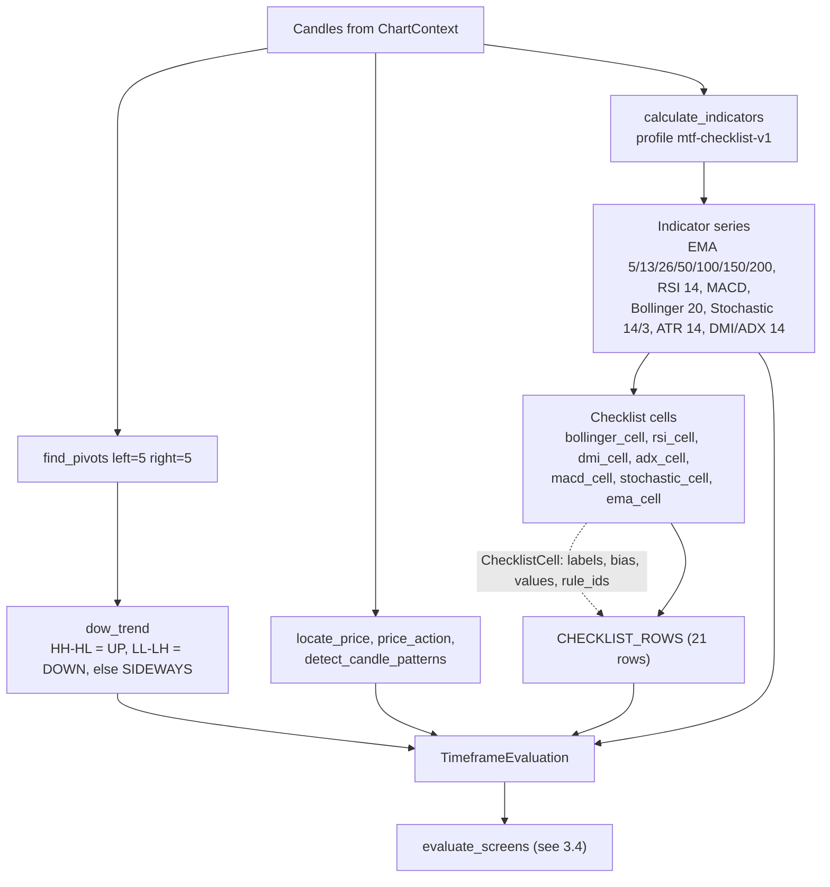

Indicator conventions match TradingView Pine:
- EMA is seeded with an SMA.
- RSI, ATR and DMI/ADX use Wilder's RMA.
- Bollinger Bands use the population standard deviation.

Thresholds come from `ChecklistThresholds` (version `mtf-checklist-v1`): recent-crossover window 3, slope lookback 3, RSI neutral band 45 to 55, Bollinger near-median fraction 0.10, Bollinger flat tolerance 0.005, S/R proximity 1.0 ATR, MACD near-zero fraction 0.10, pivot window 5, Dow v2 significance 0.5 ATR, wick tolerance 0.02. The additive Dow v2 row uses only closed candles, normalizes alternating swings, and reports contracting/expanding ranges plus structure breaks; it does not feed screen decisions.

### 3.4 Screen decisions (`evaluate_screens`)

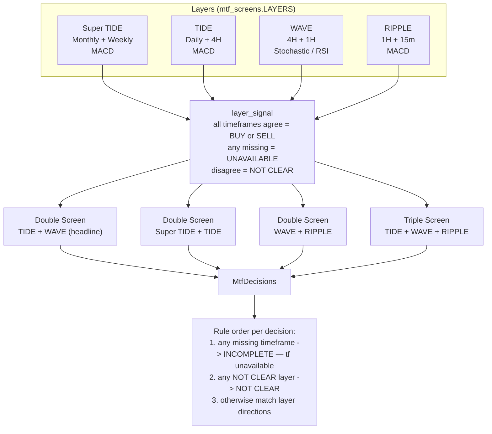

Decision text examples: `BUY`, `SELL`, `No Buy — wait for WAVE to align with TIDE`, and `INCOMPLETE — 4h unavailable`. The response carries one disclaimer at `decisions.disclaimer`: `Checklist signal derived from the SMM Double/Triple Screen rules — not financial advice.`

### 3.5 Cache and freshness

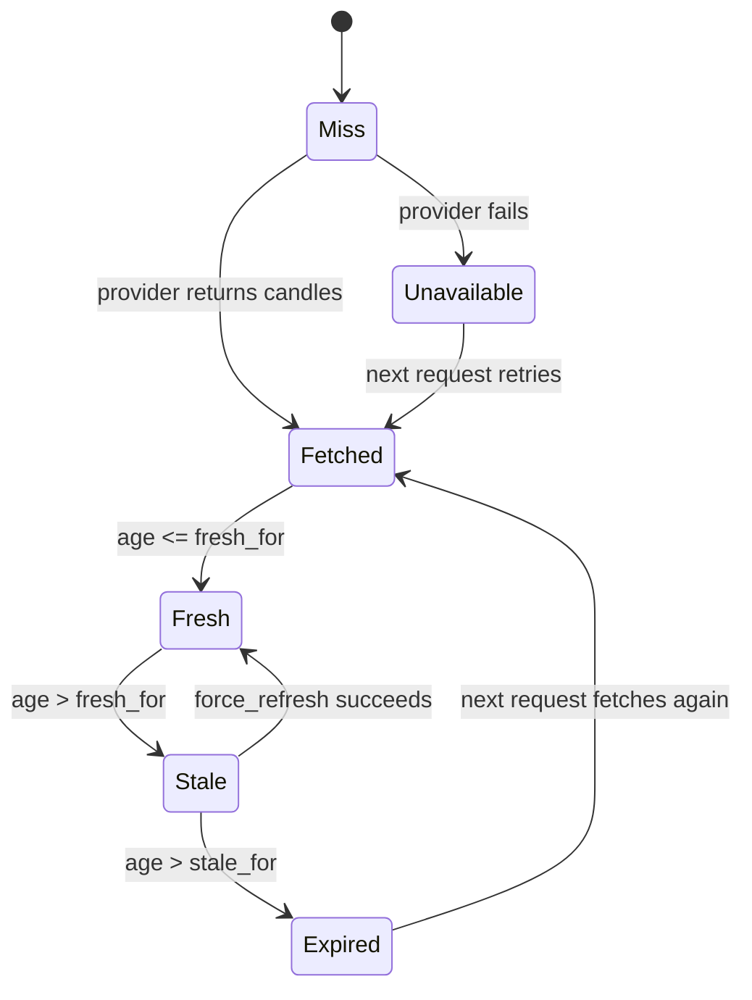

Freshness is measured from the latest candle's source timestamp, not from when the cache entry was written.

| Timeframe | `fresh_for` | `stale_for` |
| --- | --- | --- |
| Monthly | 40 days | 70 days |
| Weekly | 9 days | 16 days |
| Daily | 36 hours | 72 hours |
| 4H | 6 hours | 14 hours |
| 1H | 2 hours | 5 hours |
| 15m | 35 minutes | 2 hours |

Default for any other timeframe: 36 hours and 72 hours. The cache is per process and keyed by source, symbol and timeframe. It stores no raw payloads and no credentials.

Stale handling: `MultiTimeframeAnalysisService` refetches stale timeframes once with `force_refresh`. If that fetch fails, the earlier stale context stays and the response reports it as `STALE`.

### 3.6 Orchestrator concurrency

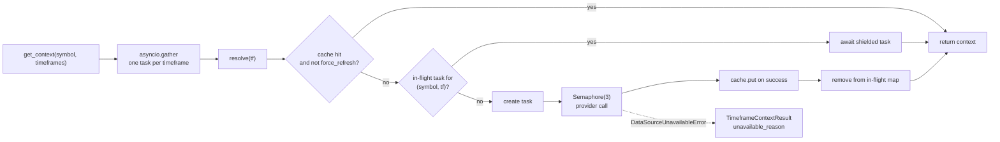

Two requests for the same symbol and timeframe share one provider call. A cancelled caller does not cancel the shared task.

### 3.7 Live candle rule

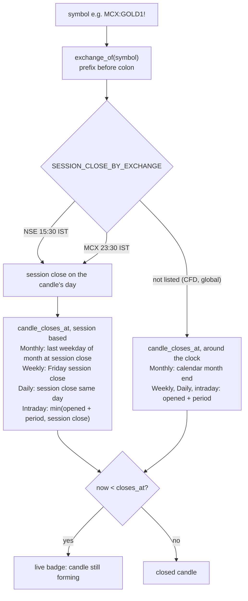

Known limit: MCX holiday calendars and DST schedules are not modelled. The MCX 23:30 close is a fixed approximation.

### 3.8 Frontend structure

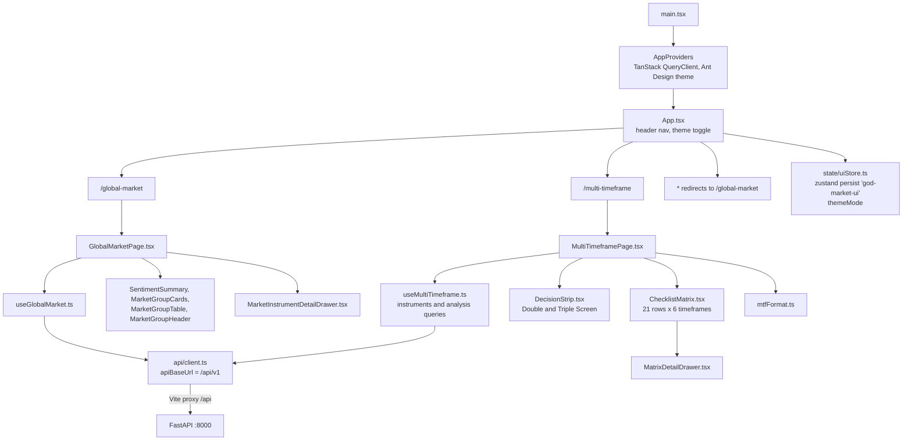

The MTF page opens one WebSocket per selected symbol (`useMtfLive`) and writes each update into the analysis query cache. Reconnect uses exponential backoff and a 90-second silence watch. The analysis query is keyed by symbol. The instruments catalogue uses `staleTime: Infinity`. A refresh calls `getMtfAnalysis(symbol, 'force_refresh')` and writes the result into the query cache. The Global Market query is keyed by timeframe. The instrument dropdown is grouped by section (`INTERNATIONAL - STUDY, TA ANALYSIS` and `INDIA MCX`), and the default is `PEPPERSTONE:NATGAS`.

### 3.9 API contract

| Method and path | Purpose | Success | Errors |
| --- | --- | --- | --- |
| `GET /health` | Service and source readiness | `200 ServiceHealth` | none |
| `GET /api/v1/chart-context/{symbol}?timeframe=` | One normalised chart context | `200 ChartContext` | `503` when the provider raises `DataSourceUnavailableError` (for example, OAuth not connected) |
| `GET /api/v1/multi-timeframe-context/{symbol}?timeframe=` (repeatable) | Assembled timeframe evidence | `200` complete or partial | `503` with a typed result when no timeframe is usable |
| `GET /api/v1/mtf-analysis/instruments` | `PS_Commodity` catalogue | `200 MtfInstrumentCatalog` | none |
| `GET /api/v1/mtf-analysis/{symbol}?refresh_mode=prefer_cache\|force_refresh` | Checklist, layers, screens | `200 MultiTimeframeAnalysis` | `422` symbol outside snapshot |
| `GET /api/v1/global-market-sentiment?timeframe=` | Ordered `PS_Global_Indices` groups and breadth | `200 GlobalMarketSnapshot` | no HTTP error mapping; unavailable items are marked with warnings |
| `GET /api/v1/oauth/official/status` | OAuth state: status, completed time, tool count, error | `200` | none; errors appear in the `error` field |
| `POST /api/v1/oauth/official/start` | Begin PKCE authorization | `200` with `authorization_url` | `502` when the flow cannot start |
| `GET /api/v1/oauth/official/callback?code&state` | Complete the authorization | `200` status message | errors are reported through the coordinator status |

### 3.10 Error and degradation handling

| Condition | Where it is caught | User-visible result |
| --- | --- | --- |
| OAuth not connected | `OfficialMCPProvider` raises `DataSourceUnavailableError` | Timeframe `UNAVAILABLE` with reason; screen `INCOMPLETE` |
| MCP call fails for another reason | Orchestrator catch-all | Generic "could not provide this timeframe" reason |
| Symbol not in snapshot | `UnknownInstrumentError` in service | `422` |
| Keychain read or write fails | `OAuthStorageError` | OAuth status reports the error; no tokens are printed |
| OAuth start fails | Coordinator error | `502` from `POST /oauth/official/start` |
| Desktop bridge not configured | Desktop reader | Global warning: fallback unavailable |
| Global official request stalls | Time budget 20 s, failure limit 3 | Remaining items go to Desktop fallback or stay unavailable; warning names the stop reason |
| Stale candles | `FreshnessPolicy` | One refresh; stale kept if refresh fails |
| Watchlist snapshot missing or invalid | Service constructor | Backend fails to start (fail fast) |
| Rate limit on the chart-context technical snapshot | Provider | OHLCV still returned; warning shown (the MTF checklist uses OHLCV only) |

### 3.11 Storage and state

| Store | Contents | Lifetime | Secrets |
| --- | --- | --- | --- |
| `data/mtf_watchlist.json` | `watchlist_name`, `default_symbol`, sections with symbols, recorded date | Committed file, changed only by the sync script | No |
| In-memory `LocalContextCache` | Normalised `ChartContext` per source, symbol and timeframe | Process lifetime | Raw payloads and credentials are not stored |
| In-memory Global Market snapshot cache | Last snapshot per timeframe, 60 s | Process lifetime | No |
| macOS Keychain, service `god-market-tech-analysis` | OAuth token set and client info | Until revoked | Yes, OS-protected |
| Browser `localStorage`, key `god-market-ui` | `themeMode` | Browser profile | No |
| `.env.local` | Path to the Desktop bridge CLI | Machine-specific, git-ignored | No |

### 3.12 Configuration constants

| Constant | Value | Where |
| --- | --- | --- |
| `SNAPSHOT_PATH` | `src/god_market_api/data/mtf_watchlist.json` | `mtf_analysis.py` |
| `SESSION_CLOSE_BY_EXCHANGE` | NSE 15:30, MCX 23:30 (IST) | `mtf_analysis.py` |
| Orchestrator concurrency | 3 | `mtf_orchestrator.py` |
| Global Market concurrency | 6, 1 retry, 20 s budget, failure limit 3 | `global_market.py` |
| Official candle count | 500 for MTF, 2 for Global Market | `providers.py` |
| OAuth redirect | `http://127.0.0.1:8000/api/v1/oauth/official/callback` | `oauth.py` |
| Keychain service | `god-market-tech-analysis` | `oauth.py` |
| CDP port | 9222 | `start-local.sh`, `sync-mtf-watchlist.mjs` |
| Vite dev port and proxy | 5173, `/api` to `127.0.0.1:8000` | `frontend/vite.config.ts` |

---

## Part 4 - Verification

- Backend: 187 pytest tests passing (`uv run pytest`). Covers the instruments endpoint, analysis endpoint, 422 path, stale refresh, and the live-candle rule for NSE, MCX and around-the-clock CFDs.
- Frontend: 18 Vitest tests passing. Lint, typecheck and build clean.
- Live check: `PEPPERSTONE:NATGAS` returned `complete` with all six timeframes live.

Source files for this document: `src/god_market_api/*.py`, `scripts/start-local.sh`, `scripts/sync-mtf-watchlist.mjs`, `frontend/src/**`.
