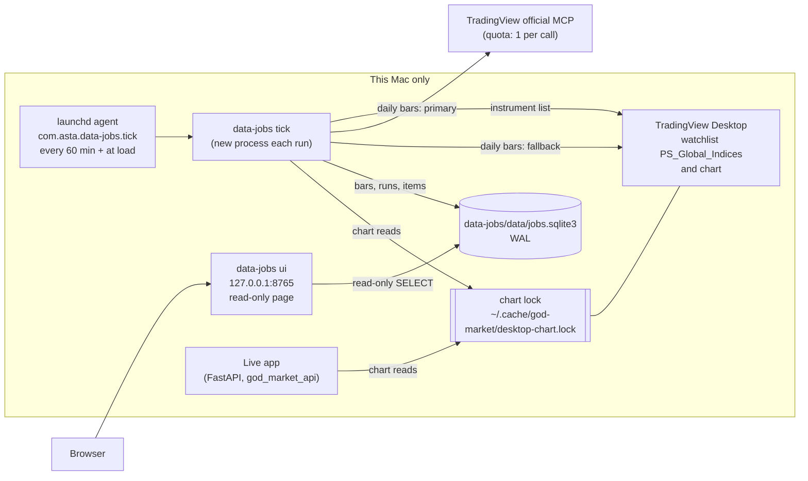
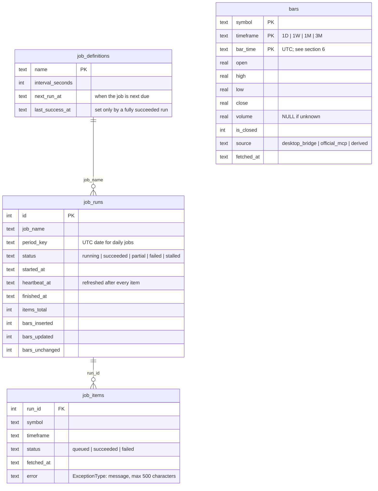
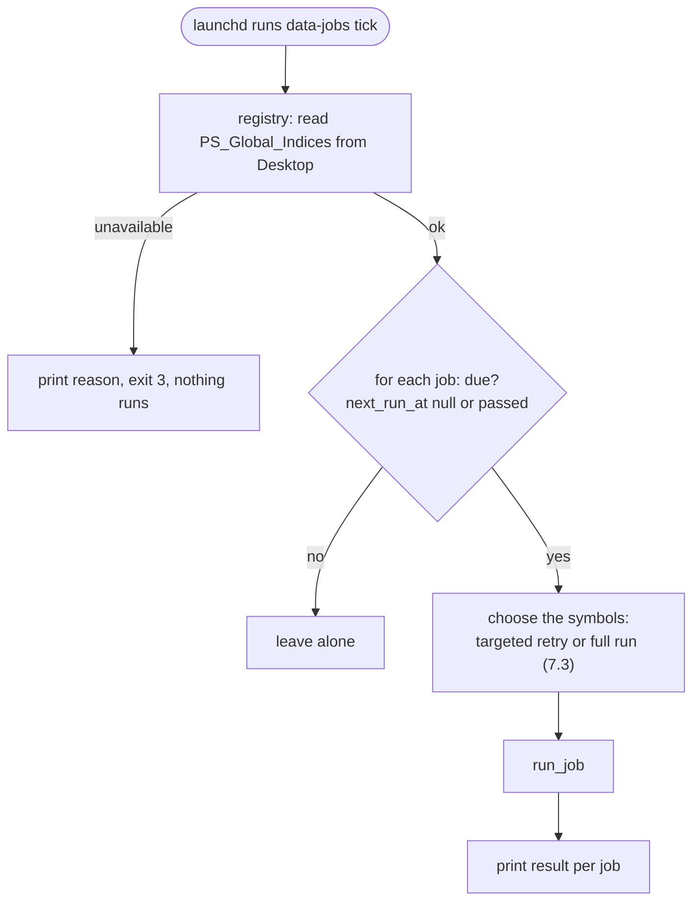
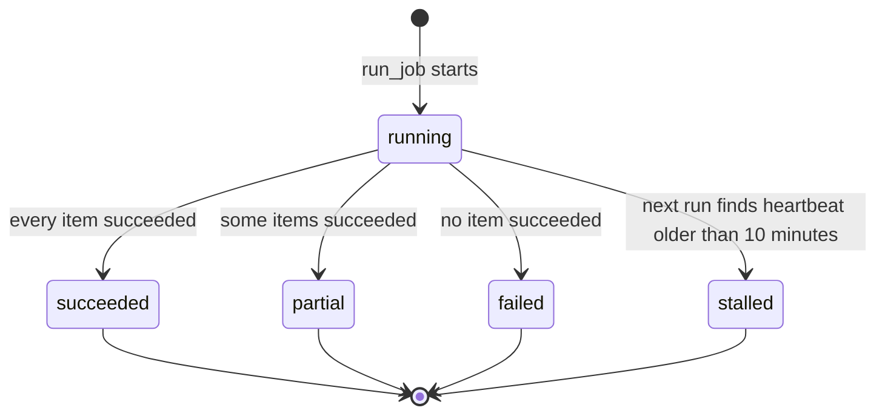

# Data jobs: system design (as built)

The data jobs are a separate, local, scheduled process. They persist daily bars for the Global Market instruments into SQLite and record each run's progress. They are independent of the live dashboard app: the live app serves the screen, the jobs fill the store.

This document describes the system as it runs today. The operating steps are in the [data-jobs runbook](../operations/data-jobs-runbook.md). The package's commands are in the [data-jobs README](../../data-jobs/README.md).

## 1. Scope

In scope today:

- One job, `global-market-daily`: daily (`1D`) bars for every instrument in the TradingView Desktop watchlist `PS_Global_Indices`.
- Weekly (`1W`), monthly (`1M`) and quarterly (`3M`) bars derived from the stored daily bars.
- Job telemetry: per run, per symbol, progress, errors and period coverage.
- A read-only progress page.
- macOS scheduling with launchd, hourly.

Out of scope today (see section 9): intraday timeframes, Windows scheduling, relative performance, and any write path from the page.

## 2. Principles

| Principle | What it means here |
| --- | --- |
| The database is the schedule | When a job is due is stored in `job_definitions.next_run_at`. launchd only wakes the process; it does not know the schedule. A missed interval (sleep, reboot) is caught up on the next tick. |
| One source of truth per fact | Bars live only in `bars`. Progress lives only in `job_runs` and `job_items`. The page and the CLI both read those tables. |
| Quota and the desktop are protected | The official MCP is the primary source. The Desktop chart is a fallback for daily bars only, capped per run, and it shares a cross-process lock with the live app. |
| Partial success is normal | A run that stores 15 of 34 symbols is recorded as `partial`, not hidden. Each failed symbol keeps its error text. |
| Writes are idempotent | Re-running a run stores the same bars and reports `unchanged`. A forming bar updates in place. |
| Failures are visible, not silent | Missing configuration stops a run with a named reason (exit code 3), and an unknown instrument fails its own item with its name in the error. |

## 3. High-level design



Three external dependencies, in order of importance:

1. **TradingView Desktop**, open with `PS_Global_Indices` visible. It supplies the instrument list every run, and daily bars when the MCP quota is used up.
2. **The official MCP**, authenticated with OAuth tokens held in the keyring. It is the primary daily source.
3. **launchd**, which wakes the process every hour.

## 4. Components

| Module (`data-jobs/src/data_jobs/`) | Responsibility |
| --- | --- |
| `cli.py` | Commands: `tick`, `status`, `ui`, `schedule install | uninstall | status`. Chooses which jobs to run. |
| `registry.py` | Builds the job specs. Reads the instrument list from the Desktop watchlist. Builds the fallback fetcher for each run. |
| `runner.py` | Runs a job: items, in-run retry, run status, next-run time, due checks, stalled-run recovery, retry selection. |
| `fallback.py` | Chooses the source for each item: MCP first; Desktop only on quota exhaustion, for daily bars, within the per-run budget, and only when Desktop is open. |
| `mcp.py` | Reads daily candles from the official MCP. Maps the MCP's quota error to the fallback's quota signal. |
| `desktop.py` | Reads daily candles from the open Desktop chart. Wraps the live app's reader, so the switch-and-restore logic and the cross-process lock are the same. |
| `trading_day.py` | Dates each daily bar to its trading day (section 6). |
| `aggregate.py` | Builds weekly, monthly and quarterly bars from daily bars. |
| `rekey.py` | One-time re-dating of stored daily bars (already applied; see the runbook). |
| `store.py` | SQLite schema, WAL, `BEGIN IMMEDIATE` transactions, upserts with change counts. |
| `telemetry.py` | Builds the JSON the page shows. Read-only. |
| `web.py` | Serves the page and `/api/status` on `127.0.0.1`. |
| `scheduler.py` | Writes, loads, unloads and inspects the launchd agent. |
| `config.py` | Absolute paths, so the scheduled run finds the same database and code whatever its working directory. |

The live app's `god_market_api` package is imported, not copied: the Desktop bridge, the chart reader, the chart lock, the watchlist parser and the MCP provider.

## 5. Data model

Four tables in `jobs.sqlite3`.



`bars` has no foreign key to the job tables: a bar records its `source`, and a run item records its symbol and timeframe, so the two are linked by value only.

Timestamps are stored as UTC text in the form `2026-10-22T00:00:00.000000Z`, so text order equals time order.

## 6. Bar time semantics

| Timeframe | `bar_time` | Built from | `is_closed` is true when |
| --- | --- | --- | --- |
| `1D` | UTC midnight of the **trading day** | Source candles, dated by `trading_day.py` | The trading day plus one day has passed |
| `1W` | Monday 00:00 UTC of the week | Daily bars, Monday to Sunday | The next week has started |
| `1M` | 1st of the month, 00:00 UTC | Daily bars | The next month has started |
| `3M` | 1st day of the quarter, 00:00 UTC | Daily bars | The next quarter has started |

**Why trading day, not UTC date.** Desktop stamps an evening-open session at the evening it opens. For example, the 22 Oct session of `BLACKBULL:US30` is stored as 21 Oct 22:00Z. Keying by UTC date would move every futures weekly and monthly boundary by a day.

**The rule** (`trading_day.py`):

1. Convert the bar's time to the instrument's exchange time zone.
2. If the instrument is in `EVENING_OPEN` and the local hour is 12:00 or later, the trading day is the next local day.
3. Otherwise the trading day is the local date.
4. Store the bar at UTC midnight of that day.

Instruments in `EVENING_OPEN`: `BLACKBULL:DJ30.F`, `BLACKBULL:US30`, `TVC:DXY`, `TVC:US10Y`, `VANTAGE:USDINR`. Every other instrument uses its local date. The rule is per instrument, not per hour: a morning session that runs in the afternoon, such as NSE's Diwali Muhurat session on 21 Oct 2025, keeps its own date.

An instrument with no exchange zone in `SESSION_ZONES` fails its own item with `UnknownSessionZone`. It is never stored under a guessed date.

**Derived periods** use only complete data. A period that starts before the first stored daily bar is held back, because its open and volume would be wrong. It is stored once the history covers it. The daily history is 300 bars, about 14 months of trading days, so the monthly and quarterly bars fill in over the first few runs.

## 7. Run lifecycle (LLD)

### 7.1 Tick



Tick is the only entry point the scheduler uses. Each invocation is a new process, so every run rebuilds the registry, reads the watchlist, and creates a fresh fallback fetcher with a new budget.

### 7.2 Run job

```mermaid
sequenceDiagram
  autonumber
  participant R as runner.run_job
  participant DB as jobs.sqlite3
  participant F as FallbackFetcher
  participant M as Official MCP
  participant D as Desktop chart
  R->>DB: BEGIN IMMEDIATE; recover stalled runs (heartbeat older than 10 min)
  alt another run of this job is running
    R-->>R: return skipped
  else
    R->>DB: insert job_runs(running), job_items(queued)
  end
  loop each symbol, timeframe (1D)
    R->>F: fetch(symbol, 1D, 300)
    F->>M: get_price_context
    alt MCP answers
      M-->>F: candles
    else quota exhausted
      F->>D: is_open()? budget left?
      D-->>F: read_daily (switch and restore, chart lock)
    end
    F-->>R: bars + source
    R->>R: on_trading_days (re-date, refuse two bars on one day)
    R->>DB: BEGIN IMMEDIATE; upsert bars; derive 1W 1M 3M; item succeeded; heartbeat
  end
  loop each failed item, once
    R->>F: fetch again (same path)
  end
  R->>DB: run status from item counts; next_run_at; COMMIT
```

Failed items store `ExceptionType: message` in `job_items.error`. A failed item does not stop the run.

### 7.3 Choosing the symbols for a run

| Latest run of this job | Same UTC date as now? | Runs so far in this period | This run |
| --- | --- | --- | --- |
| `succeeded` | any | any | full job |
| `partial` or `failed` | yes | fewer than 4 | **targeted**: the failed symbols only |
| `partial` or `failed` | yes | 4 or more | full job, no retry until the interval passes |
| `partial` or `failed` | no (a new day) | any | full job |
| `stalled` or none | any | any | full job |

After a run, the next run time is:

| Outcome | Next run |
| --- | --- |
| `succeeded` | the job interval (1 day) |
| `partial` or `failed`, fewer than 4 runs this period | 1 hour |
| `partial` or `failed`, 4 runs this period | the job interval (1 day) |

### 7.4 Run status



A `stalled` run means the process was killed, slept mid-run, or crashed. The next run marks it and starts normally. Its items that were not finished stay `queued`.

## 8. Source selection and budgets

| Rule | Value | Where |
| --- | --- | --- |
| Primary source | Official MCP, daily bars | `mcp.py` |
| Fallback trigger | Only `QuotaExhaustedError` (the MCP's quota error). Other MCP errors are reported as they are. | `fallback.py` |
| Fallback timeframe | Daily only. Weekly, monthly and quarterly are derived, never read from Desktop. | `fallback.py` |
| Desktop read budget | 80 reads per run. Counts attempts, including the in-run retry. | `DEFAULT_DESKTOP_READ_BUDGET` |
| Desktop must be open | The bridge's `status` must report success, a connected debugger and an available chart API. | `desktop.py` |
| Chart lock | Desktop reads are serialised across processes with `fcntl` on `~/.cache/god-market/desktop-chart.lock`, shared with the live app. Waits up to 45 seconds. | `god_market_api/desktop_chart_lock.py` |
| Chart load | A chart that does not load within 30 seconds fails the item. | `CHART_COMMAND_TIMEOUT_SECONDS` |

The quota guard is per process. Two processes do not share a count of MCP calls. Today only the scheduled tick and an ad-hoc run would use the MCP for jobs, so this has not been a problem, but it is a known gap.

## 9. Failure behaviour

| What fails | What the system does | How you see it |
| --- | --- | --- |
| TradingView Desktop is closed, or `PS_Global_Indices` is not the visible watchlist | Tick exits with code 3 and runs no job. No MCP call is made. | Tick log: `Instrument list unavailable, so no job ran: ...` |
| MCP quota exhausted | Daily items use the Desktop chart, within the budget. Items that cannot use it fail with a reason. | Item error, and the run is `partial` if some succeed |
| Desktop chart does not load in 30 s | The item fails. The in-run retry runs it once more; the next run retries the failed symbols. | Item error: `DataSourceUnavailableError: TradingView Desktop did not load ...` |
| Empty answer from a source | The item fails with `EmptyResponseError`. | Item error |
| Instrument with no exchange zone | The item fails with `UnknownSessionZone`. The watchlist can grow without corrupting dates. | Item error naming the symbol |
| Two bars on one trading day | The item fails; nothing is written for it. | Item error naming the day |
| A run is killed, sleeps, or crashes | The run stays `running` until a later run sees its heartbeat is older than 10 minutes. It is then marked `stalled` and the job continues. | Run status `stalled` |
| Two ticks overlap | The second sees a running run and returns `skipped`. | Tick output: `skipped, a run is already in progress` |
| The Mac was asleep past a due time | launchd runs the agent on wake. The due check reads the database, so the job runs once. | Tick output |
| A job is due long ago and has not started | Shown as `OVERDUE` after 2 hours past its due time. | `status` line and the page |
| The database is missing or not initialised | The page says no database yet. `status` says no jobs yet. | Page message |

## 10. Telemetry

`telemetry.py` builds the page's JSON. All values come from the tables above.

| Field | Meaning |
| --- | --- |
| `latest_status` | Status of the newest run of the job |
| `progress.done` | Items not queued (succeeded or failed) in the latest run |
| `progress.failed` | Items failed in the latest run |
| `last_full_success_at` | Finish time of the most recent run that **fully** succeeded. A partial run does not move it. |
| `runs` | The 10 most recent runs, with bars new, changed and unchanged |
| `items` | Every item of the latest run, with status and error |
| `coverage` | The 7 most recent periods, newest first. A period is `succeeded` if any of its runs succeeded, otherwise the status of its latest run. |
| `overdue` | Due more than 2 hours ago and not running |

## 11. Security and privacy

- The page binds to `127.0.0.1` by default. It has no authentication, so do not bind it to a LAN address.
- The page is read-only: it issues only `SELECT` statements and never runs a job.
- The OAuth tokens stay in the keyring. The bridge settings are copied from `.env.local` into the launchd agent file, which is in the user's home directory.
- The database and the logs stay on this Mac.

## 12. Decisions and why

| Decision | Why | Alternative rejected |
| --- | --- | --- |
| SQLite in WAL mode | One local writer, one or more readers (the page), no server to run | PostgreSQL: overkill for a single-user Mac |
| launchd hourly tick, schedule in the DB | Survives sleep and reboot; one place to change schedules | A cron entry per job, or a long-running daemon |
| Instrument list from Desktop | Costs no MCP quota; the watchlist is the user's own list | A list in code (stale); the MCP watchlist (costs quota) |
| Derived weekly, monthly, quarterly | Costs no quota; one daily fetch serves all periods | Separate fetches per timeframe (quota cost, no benefit) |
| Trading-day keying | Futures and forex weekly and monthly boundaries match the instrument's own sessions | UTC-date keying (shifted boundaries) |
| Per-instrument evening rule | An hour rule breaks afternoon morning sessions (Muhurat) | An hour-only rule |
| Partial runs retried sooner, for failed symbols only | A full re-run each hour would cost the whole watchlist's quota and chart time | Full re-run each hour |
| Process-per-tick, no daemon | Simple to reason about, restarts cleanly, no state held in memory | A resident scheduler |

## 13. Known limitations and open risks

| Area | Status |
| --- | --- |
| Official MCP adapter | Not run live. The call path, the 300-bar request size, and the MCP's timestamp convention are unverified. |
| MCP timestamp convention | If the MCP stamps a US morning-session bar at midnight UTC, its trading day would be one day early. This must be checked against a real MCP response before the MCP is trusted for dating. |
| Derived bars vs TradingView | Weekly and monthly bars have not been compared to TradingView's own charts. That needs chart switching and approval. |
| Trading-day table | It matches the live `PS_Global_Indices` list (34 instruments) as of 22 Oct 2026. A new instrument fails its item until it is added to `SESSION_ZONES` (and `EVENING_OPEN` if its session opens in the evening). |
| Evening rule evidence | Checked against the stored stamps of the 15 instruments whose history was stored on 22 Oct 2026. Not yet checked for the 19 that failed that day. |
| Desktop reliability | 19 of 34 items failed on the first run because charts did not load in 30 seconds. Retries are in place; the timeout itself is unchanged. |
| Re-keying | `rekey.py` is one-time and already applied. It is **not idempotent**: running it again would move already re-dated bars by a day. See the runbook. |
| Quota guard | Per process, not shared. |
| Intraday | 4H and 1H jobs are not built. |
| Windows | Not supported. Task Scheduler is deferred. |
| Gitignore | `*.sqlite3` is ignored, but `-wal`, `-shm` and `.bak` files under `data-jobs/data/` are not. |
